<!-- BANNER PRINCIPAL: Sube tu propio atardecer en pixel art a una carpeta "assets" en tu repo -->

# Hola, soy LauDumbThings👾
*(pero me suelen llamar Laura)*

 

-ff007f?style=for-the-badge)

  

---

### 🖥️ `C:\USERS\LauDumbThings\README.TXT`

Soy estudiante de **3º de Ingeniería Multimedia** y uso este rincón de internet como mi cartelera personal. Soy una persona muy flexible, hoy hacemos un proyecto serio y al día siguiente aparezco en uno de los proyectos más estúpidos jamás existidos.

Mi objetivo a futuro es convertirme en **Full Stack**, pero por el camino me niego a perder la parte creativa: me flipa el diseño web, trastear con **Blender**, la **producción musical** y la **ciberseguridad**. Básicamente, me apunto a programar cualquier cosa... *preferiblemente si no es algo demasiado importante*.

---

### 🛠️ Stack y herramientas

**Lo que sabemos (más o menos):**

  
  
  
  
  
  
  
  
  
  
  

**Aprendiendo sobre la marcha:**

  
  
  
  
  
  
  
  
  

**Mi relación más tóxica:**

  

---

### ¿Qué hago ahora?

> *Actualmente con proyectos un poco abandonados que volverán a casa (como en Navidad)*

---

### 🕹️ Pac-Man

<picture data-importer="pacman">
  <source media="(prefers-color-scheme: dark)" srcset="https://raw.githubusercontent.com/lauranh05/lauranh05/pacman-output/pacman-contribution-graph-dark.svg?game=pacman">
  <source media="(prefers-color-scheme: light)" srcset="https://raw.githubusercontent.com/lauranh05/lauranh05/pacman-output/pacman-contribution-graph.svg?game=pacman">
  
</picture>

Hecho con amor a las 2 de la mañana &lt;3 

